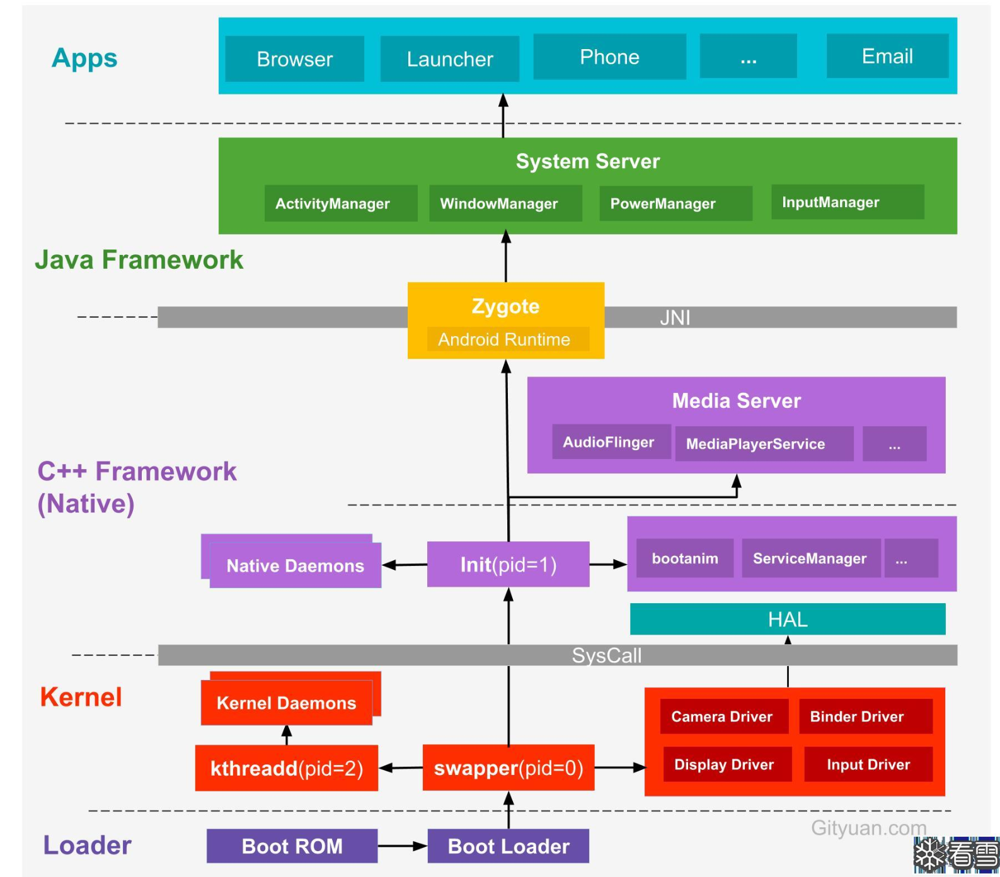
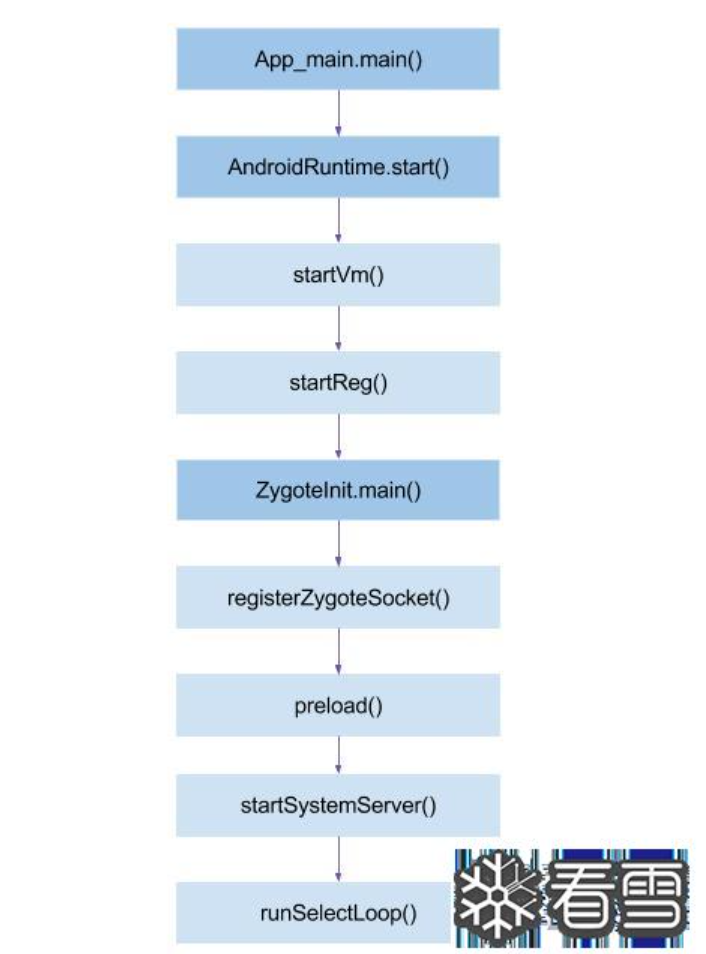
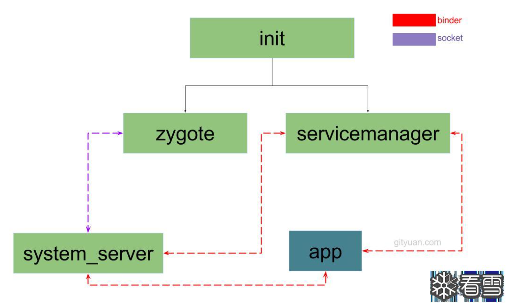

# Android各启动流程与机制杂谈

## Android内核启动流程

### 大致流程

引导加载程序-内核启动-init进程启动-Zygote进程启动-System Server进程-启动框架和用户界面



#### Loader

`SoC` 芯片内部有固化的一块只读存储器`Boot Rom`，芯片出厂时，厂商就把第一段启动代码烧录在里面，通常不可修改、掉电不丢失，电源键触发后，`CPU` 硬件从 `Boot ROM` 中的预设代码开始取指执行，`Boot ROM` 完成最基础的硬件初始化、启动介质检测和必要的安全校验后，从启动介质读取下一级引导程序，把它加载到 `SoC` 内部 `SRAM` 或已初始化好的 `RAM` 中，然后跳转执行，交出控制权，来到`Boot Loader`，`Boot Loader`带领进入`Kernel`层

#### Kernel

`bootloader` 把控制权交给 `Linux kernel`，进入内核入口执行 `start_kernel`，然后创建 `swapper` 也就是 `idle` 进程 `pid = 0`，初始化内存管理、调度、驱动等，最后启动用户空间第一个进程 `init` `pid = 1`，然后启动`kthreadd`，`pid = 2`，由 `swapper` 也就是 `idle` 在内核启动的 `rest_init` 里创建，它是所有内核线程的父进程，负责创建 `kworker`、`ksoftirqd`、`thermal` 等内核守护线程，`init` 此时开始解析 `init.rc`，转到`Native`层

#### Native

`init` 进程会孵化出许多用户守护进程，还启动 `servicemanager` 也就是 `binder` 服务管家、`bootanim` 也就是开机动画等重要服务，最重要的是`init` 进程孵化出 `Zygote` 进程，`Zygote` 进程是 `Android` 系统的第一个 `Java` 进程 即虚拟机进程，`Zygote` 是所有 `Java` 进程的父进程，此时进入了`JAVA Framework`层

#### JAVA Framework

此时`Zygote` 加载 `ZygoteInit` 类，注册 `Zygote Socket` 服务端套接字，加载虚拟机`ART`，提前加载类 `preloadClasses`，提前加载资源 `preloadResources`，后面 `fork` 出来的 `App` 直接继承，不用每个 `App` 都重新加载，启动更快也更省内存

`Zygote` 孵化的第一个进程是 `SystemServer`，此进程负责启动与管理整个 `Java Framework`，包含了 `ActivityManager`、`WindowManager`、`PackageManager`、`PowerManager` 等服务，给 `App` 和系统组件提供能力

#### App

`Zygote` 进程孵化出的第一个 `app` 进程为 `Launcher`，通俗来讲就是我们的桌面 `app`，所有的 `app` 进程都是由 `zygote` 进程 `fork` 而来的  

#### init详解

第一阶段先判断是不是第一阶段，因为第一阶段最后会 `execv` 重启 `/init`，再次进 `main` 时 `INIT_SECOND_STAGE` 已经设置，第二次会跳过第一阶段，这是入口判断

第一阶段主要是加载必要文件，用 `mount` 挂载 `tmpfs`、`proc`、`sysfs`、`selinuxfs` 等虚拟文件系统，创建设备节点比如 `/dev/kmsg`、`/dev/random`，设置 `SELinux`，初始化 `selinux_initialize(true)` 加载安全策略，恢复 `/init` 上下文 `selinux_android_restorecon("/init", 0)`，切换第二阶段并做域转换，设置 `setenv("INIT_SECOND_STAGE", "true", 1)`，用 `execv` 重新启动 `/init` 程序，把域从 `kernel` 切到 `init`  

第二阶段则重新初始化 `SELinux` 并恢复上下文，初始化属性系统，处理内核 `dt` 和 `cmdline`，导出 `ro.boottime.init` 等属性，清理第一阶段环境变量，建立 `epoll` 和信号处理，启动属性服务，解析 `/init.rc`，按脚本启动 `servicemanager`、`Zygote` 等关键服务

为什么需要两次`init`？一是环境不完整，二是 `SELinux` 域问题

第一次 `/init` 是内核直接执行的，这时根文件系统还是 `ramdisk` 临时根，`system`、`vendor` 等还没挂，`SELinux` 策略也还没加载，所以只能做最基础的事，挂 `tmpfs`、`proc`、`sysfs`、`selinuxfs`，建 `/dev/kmsg`、`/dev/random` 这些节点，挂必要分区，加载 `SELinux` 策略，恢复 `/init` 上下文

这些做完后，环境才够完整，才能解析 `/system/etc/init`、`/vendor/etc/init` 和完整 `init.rc`，启动 `Zygote`、`servicemanager` 这些服务，所以需要第二次执行 `/init`

且第一次 `/init` 跑在 `kernel` 域，权限太大，加载策略并 `restorecon /init` 后，用 `execv` 重新执行 `/init`，进程就会从 `kernel` 域切到 `init` 域，权限被策略约束，更安全

然后我们讨论到`init`->`zygote`的过程

##### init_to_zygote



`init` 第二阶段解析 `init.rc` 和 `import` 进来的 `init.zygote.rc`

```rc
service zygote /system/bin/app_process64 -Xzygote /system/bin --zygote --start-system-server
    class main
    socket zygote stream 660 root system
    onrestart write /sys/android_power/request_state wake
    onrestart restart audioserver
    onrestart restart cameraserver
    writepid /dev/cpuset/foreground/tasks
    critical
```

`init` 执行 `/system/bin/app_process64` 后，进入 `app_main.cpp` 的 `main`

追到`app_main.cpp`

```cpp
int main(int argc, char* const argv[])
{
    if (!LOG_NDEBUG) {
      String8 argv_String;
      for (int i = 0; i < argc; ++i) {
        argv_String.append("\"");
        argv_String.append(argv[i]);
        argv_String.append("\" ");
      }
      ALOGV("app_process main with argv: %s", argv_String.c_str());
    }

    AppRuntime runtime(argv[0], computeArgBlockSize(argc, argv));
    argc--;
    argv++;


    const char* spaced_commands[] = { "-cp", "-classpath" };
    // Allow "spaced commands" to be succeeded by exactly 1 argument (regardless of -s).
    bool known_command = false;

    int i;
    for (i = 0; i < argc; i++) {
        if (known_command == true) {
          runtime.addOption(strdup(argv[i]));

          ALOGV("app_process main add known option '%s'", argv[i]);
          known_command = false;
          continue;
        }

        for (int j = 0;
             j < static_cast<int>(sizeof(spaced_commands) / sizeof(spaced_commands[0]));
             ++j) {
          if (strcmp(argv[i], spaced_commands[j]) == 0) {
            known_command = true;
            ALOGV("app_process main found known command '%s'", argv[i]);
          }
        }

        if (argv[i][0] != '-') {
            break;
        }
        if (argv[i][1] == '-' && argv[i][2] == 0) {
            ++i; // Skip --.
            break;
        }

        runtime.addOption(strdup(argv[i]));

        ALOGV("app_process main add option '%s'", argv[i]);
    }
//运行模式
    // Parse runtime arguments.  Stop at first unrecognized option.
    bool zygote = false;
    bool startSystemServer = false;
    bool application = false;
    String8 niceName;
    String8 className;

    //提取argv中的模式与参数
    ++i;  // Skip unused "parent dir" argument.
    while (i < argc) {
        const char* arg = argv[i++];
        if (strcmp(arg, "--zygote") == 0) {
            zygote = true;
            niceName = ZYGOTE_NICE_NAME;
        } else if (strcmp(arg, "--start-system-server") == 0) {
            startSystemServer = true;
        } else if (strcmp(arg, "--application") == 0) {
            application = true;
        } else if (strncmp(arg, "--nice-name=", 12) == 0) {
            niceName = (arg + 12);
        } else if (strncmp(arg, "--", 2) != 0) {
            className = arg;
            break;
        } else {
            --i;
            break;
        }
    }

    Vector<String8> args;
    if (!className.empty()) {
        // We're not in zygote mode, the only argument we need to pass
        // to RuntimeInit is the application argument.
        //
        // The Remainder of args get passed to startup class main(). Make
        // copies of them before we overwrite them with the process name.
        args.add(application ? String8("application") : String8("tool"));
        runtime.setClassNameAndArgs(className, argc - i, argv + i);

        if (!LOG_NDEBUG) {
          String8 restOfArgs;
          char* const* argv_new = argv + i;
          int argc_new = argc - i;
          for (int k = 0; k < argc_new; ++k) {
            restOfArgs.append("\"");
            restOfArgs.append(argv_new[k]);
            restOfArgs.append("\" ");
          }
          ALOGV("Class name = %s, args = %s", className.c_str(), restOfArgs.c_str());
        }
    } else {
        //这里是在Zygote模式
        // We're in zygote mode.
        maybeCreateDalvikCache();//确保 Dalvik 缓存存在（如有必要则创建）

        if (startSystemServer) {
            args.add(String8("start-system-server"));
        }

        char prop[PROP_VALUE_MAX];
        if (property_get(ABI_LIST_PROPERTY, prop, NULL) == 0) {
            LOG_ALWAYS_FATAL("app_process: Unable to determine ABI list from property %s.",
                ABI_LIST_PROPERTY);
            return 11;
        }

        String8 abiFlag("--abi-list=");
        abiFlag.append(prop);//从系统属性中获取 ABI 列表（支持的架构），并将其作为 --abi-list 选项传递给 Zygote
        args.add(abiFlag);

        // In zygote mode, pass all remaining arguments to the zygote
        // main() method.
        for (; i < argc; ++i) {
            args.add(String8(argv[i]));
        }
    }

    if (!niceName.empty()) {
        runtime.setArgv0(niceName.c_str(), true /* setProcName */);
    }
//最后的部分是启动了java中的这个类/或者是独立模式
    if (zygote) {
        runtime.start("com.android.internal.os.ZygoteInit", args, zygote);
    } else if (!className.empty()) {
        runtime.start("com.android.internal.os.RuntimeInit", args, zygote);
    } else {
        fprintf(stderr, "Error: no class name or --zygote supplied.\n");
        app_usage();
        LOG_ALWAYS_FATAL("app_process: no class name or --zygote supplied.");
    }
}
```

`AppRuntime runtime(argv[0], computeArgBlockSize(argc, argv));`
创建 `AppRuntime`，它继承 `AndroidRuntime`，后面 `runtime.start` 实际调的是 `AndroidRuntime::start`，这里的`AppRuntime`，它的作用是收好参数，把流程带进 `AndroidRuntime`

`runtime.start("com.android.internal.os.ZygoteInit", args, zygote);`
，把 `native` 的 `app_process` 接到 `Java` 的 `ZygoteInit`

创建 `AppRuntime` 后，`main` 解析参数，判断是 `Zygote` 模式，最后调 `runtime.start("com.android.internal.os.ZygoteInit", args, zygote)`

`runtime.start` 实际进 `AndroidRuntime::start`，里面调 `startVm` 创建 `ART`，调 `startReg` 注册 `JNI`，然后用 `JNI` 找到 `ZygoteInit` 类，调它的静态 `main`

`ZygoteInit.main` 里先 `registerZygoteSocket` 注册 `zygote socket`，再 `preload` 预加载类和资源，然后 `startSystemServer` `fork` 出 `system_server`，最后 `runSelectLoop` 等 `AMS` 通过 `zygote socket` 发请求来 `fork` 新 `app`

## Android App启动流程



### AMS侧

`AMS` 向 `Zygote` 发送启动请求，当 `startActivity` 发现目标进程不存在，就调 `startProcessLocked`

```java
//frameworks/base/services/core/java/com/android/server/am/ActivityManagerService.java    
 private final void startProcessLocked(ProcessRecord app, String hostingType,
            String hostingNameStr, String abiOverride, String entryPoint, String[] entryPointArgs) {
  //...... check time
        try {
            try {
                final int userId = UserHandle.getUserId(app.uid);
                AppGlobals.getPackageManager().checkPackageStartable(app.info.packageName, userId);
            } catch (RemoteException e) {
                throw e.rethrowAsRuntimeException();
            }

            //1.获取要创建的应用程序进程的用户ID
            int uid = app.uid;
            int[] gids = null;
            int mountExternal = Zygote.MOUNT_EXTERNAL_NONE;
            if (!app.isolated) {
    //...... check
                /*
                 * Add shared application and profile GIDs so applications can share some
                 * resources like shared libraries and access user-wide resources
                 */
                //2.对gids进行创建和赋值
                if (ArrayUtils.isEmpty(permGids)) {
                    gids = new int[3];
                } else {
                    gids = new int[permGids.length + 3];
                    System.arraycopy(permGids, 0, gids, 3, permGids.length);
                }
                gids[0] = UserHandle.getSharedAppGid(UserHandle.getAppId(uid));
                gids[1] = UserHandle.getCacheAppGid(UserHandle.getAppId(uid));
                gids[2] = UserHandle.getUserGid(UserHandle.getUserId(uid));
            }
            // check time and others .......
            
            // Start the process.  It will either succeed and return a result containing
            // the PID of the new process, or else throw a RuntimeException.
            //3.如果entryPoint=null,则赋值为"android.app.ActivityThread" 即应用程序进程主线程的类名
            boolean isActivityProcess = (entryPoint == null);
            if (entryPoint == null) entryPoint = "android.app.ActivityThread";
            Trace.traceBegin(Trace.TRACE_TAG_ACTIVITY_MANAGER, "Start proc: " +
                    app.processName);
            checkTime(startTime, "startProcess: asking zygote to start proc");
            ProcessStartResult startResult;
            //判断是否为webview服务
            if (hostingType.equals("webview_service")) {
                //启动webview
                startResult = startWebView(entryPoint,
                        app.processName, uid, uid, gids, debugFlags, mountExternal,
                        app.info.targetSdkVersion, seInfo, requiredAbi, instructionSet,
                        app.info.dataDir, null, entryPointArgs);
            } else {
                //4.调用Process.start启动应用程序进程
                startResult = Process.start(entryPoint,
                        app.processName, uid, uid, gids, debugFlags, mountExternal,
                        app.info.targetSdkVersion, seInfo, requiredAbi, instructionSet,
                        app.info.dataDir, invokeWith, entryPointArgs);
            }
   //......
        } catch (RuntimeException e) {
   //......
        }
    }
```

`StartProcessLocked`获取创建了`uid gid`，然后设置`entryPoint`，最后调用`Process.start`

`Process.start`内部调用了`zygoteProcess.start`

```java
//frameworks/base/core/java/android/os/Process.java    
 public static final ProcessStartResult start(final String processClass,
                                  final String niceName,
                                  int uid, int gid, int[] gids,
                                  int debugFlags, int mountExternal,
                                  int targetSdkVersion,
                                  String seInfo,
                                  String abi,
                                  String instructionSet,
                                  String appDataDir,
                                  String invokeWith,
                                  String[] zygoteArgs) {
        return zygoteProcess.start(processClass, niceName, uid, gid, gids,
                    debugFlags, mountExternal, targetSdkVersion, seInfo,
                    abi, instructionSet, appDataDir, invokeWith, zygoteArgs);
    }
```

`ZygoteProcess.start`调用了`startViaZygote`

```java
//frameworks/base/core/java/android/os/ZygoteProcess.java    
 public final Process.ProcessStartResult start(final String processClass,
                                                  final String niceName,
                                                  int uid, int gid, int[] gids,
                                                  int debugFlags, int mountExternal,
                                                  int targetSdkVersion,
                                                  String seInfo,
                                                  String abi,
                                                  String instructionSet,
                                                  String appDataDir,
                                                  String invokeWith,
                                                  String[] zygoteArgs) {
        try {
            return startViaZygote(processClass, niceName, uid, gid, gids,
                    debugFlags, mountExternal, targetSdkVersion, seInfo,
                    abi, instructionSet, appDataDir, invokeWith, zygoteArgs);
        } catch (ZygoteStartFailedEx ex) {
            Log.e(LOG_TAG,
                    "Starting VM process through Zygote failed");
            throw new RuntimeException(
                    "Starting VM process through Zygote failed", ex);
        }
    }
```

`ZygoteProcess.startViaZygote`保存应用进程的启动参数后,调用`zygoteSendArgsAndGetResult`

首先调用了`openZygoteSocketIfNeeded`

```java
//frameworks/base/core/java/android/os/ZygoteProcess.java
 private Process.ProcessStartResult startViaZygote(final String processClass,
                                                      final String niceName,
                                                      final int uid, final int gid,
                                                      final int[] gids,
                                                      int debugFlags, int mountExternal,
                                                      int targetSdkVersion,
                                                      String seInfo,
                                                      String abi,
                                                      String instructionSet,
                                                      String appDataDir,
                                                      String invokeWith,
                                                      String[] extraArgs)
                                                      throws ZygoteStartFailedEx {
        //1.创建字符串列表,用于保存应用进程的启动参数
        ArrayList<String> argsForZygote = new ArrayList<String>();

        // --runtime-args, --setuid=, --setgid=,
        // and --setgroups= must go first
        argsForZygote.add("--runtime-args");
        argsForZygote.add("--setuid=" + uid);
        argsForZygote.add("--setgid=" + gid);
        if ((debugFlags & Zygote.DEBUG_ENABLE_JNI_LOGGING) != 0) {
            argsForZygote.add("--enable-jni-logging");
        }
  //......
  
        synchronized(mLock) {
            return zygoteSendArgsAndGetResult(openZygoteSocketIfNeeded(abi), argsForZygote);
        }
    }
```

`ZygoteProcess.openZygoteSocketIfNeeded`如下,主要是和`Zygote`进程通过`Socket`建立连接,并返回`Zygote`进程的状态

```java
//frameworks/base/core/java/android/os/ZygoteProcess.java    
 /**
     * Tries to open socket to Zygote process if not already open. If
     * already open, does nothing.  May block and retry.  Requires that mLock be held.
     */
    @GuardedBy("mLock")
    private ZygoteState openZygoteSocketIfNeeded(String abi) throws ZygoteStartFailedEx {
        //检查当前线程是否持有mLock锁,没有则抛出异常
        Preconditions.checkState(Thread.holdsLock(mLock), "ZygoteProcess lock not held");

        if (primaryZygoteState == null || primaryZygoteState.isClosed()) {
            try {
                //通过Socket与主Zygote进程建立连接
                primaryZygoteState = ZygoteState.connect(mSocket);
            } catch (IOException ioe) {
                throw new ZygoteStartFailedEx("Error connecting to primary zygote", ioe);
            }
        }

        //检查主Zygote进程和目标进程abi是否匹配,匹配则返回主Zygote进程状态
        if (primaryZygoteState.matches(abi)) {
            return primaryZygoteState;
        }

        // The primary zygote didn't match. Try the secondary.
        // abi不匹配,尝试与辅Zygote进程建立连接
        if (secondaryZygoteState == null || secondaryZygoteState.isClosed()) {
            try {
                //通过Socket与辅Zygote进程建立连接
                secondaryZygoteState = ZygoteState.connect(mSecondarySocket);
            } catch (IOException ioe) {
                throw new ZygoteStartFailedEx("Error connecting to secondary zygote", ioe);
            }
        }
        //返回辅zygote进程状态
        if (secondaryZygoteState.matches(abi)) {
            return secondaryZygoteState;
        }
        throw new ZygoteStartFailedEx("Unsupported zygote ABI: " + abi);
    }
```

`zygoteSendArgsAndGetResult`代码如下

主要功能为将应用进程启动参数写入`zygoteState`(`ZygoteProcess`的静态内部类,用于表示与`Zygote`进程的通信状态)

然后与`Zygote`进程通信,等待发送新创建的进程`pid`和`usingWrapper`; 如果`pid>=0`则进程创建成功

```java
//frameworks/base/core/java/android/os/ZygoteProcess.java    
 @GuardedBy("mLock")
    private static Process.ProcessStartResult zygoteSendArgsAndGetResult(
            ZygoteState zygoteState, ArrayList<String> args)
            throws ZygoteStartFailedEx {
        try {
            // Throw early if any of the arguments are malformed. This means we can
            // avoid writing a partial response to the zygote.
            //1.检查args数组的参数
            int sz = args.size();
            for (int i = 0; i < sz; i++) {
                if (args.get(i).indexOf('\n') >= 0) {
                    throw new ZygoteStartFailedEx("embedded newlines not allowed");
                }
            }

            /**
             * See com.android.internal.os.SystemZygoteInit.readArgumentList()
             * Presently the wire format to the zygote process is:
             * a) a count of arguments (argc, in essence)
             * b) a number of newline-separated argument strings equal to count
             *
             * After the zygote process reads these it will write the pid of
             * the child or -1 on failure, followed by boolean to
             * indicate whether a wrapper process was used.
             */
            //2.将参数写入ZygoteState中
            final BufferedWriter writer = zygoteState.writer;
            final DataInputStream inputStream = zygoteState.inputStream;
            
            writer.write(Integer.toString(args.size()));
            writer.newLine();

            for (int i = 0; i < sz; i++) {
                String arg = args.get(i);
                writer.write(arg);
                writer.newLine();
            }

            writer.flush();

            // Should there be a timeout on this?
            
            Process.ProcessStartResult result = new Process.ProcessStartResult();

            // Always read the entire result from the input stream to avoid leaving
            // bytes in the stream for future process starts to accidentally stumble
            // upon.
            //3.等待socket服务端(即Zygote) 返回新创建的进程pid,usingWrapper
            result.pid = inputStream.readInt();
            result.usingWrapper = inputStream.readBoolean();

            if (result.pid < 0) {
                throw new ZygoteStartFailedEx("fork() failed");
            }
            return result;
        } catch (IOException ex) {
            zygoteState.close();
            throw new ZygoteStartFailedEx(ex);
        }
    }
```

### Zygote侧

`Zygote`进程通过`Socket`接收创建新应用进程的请求,回到`ZygoteInit.main`方法中,我们上面也提过`Zygote`通过`runselectloop`轮询等待`AMS`请求

```java
    public static void main(String argv[]) {
        ZygoteServer zygoteServer = new ZygoteServer();
  //......
        try {
   //......
   //1.创建Server端的Socket,socketName="zygote"
            zygoteServer.registerServerSocket(socketName);
            // In some configurations, we avoid preloading resources and classes eagerly.
            // In such cases, we will preload things prior to our first fork.
            if (!enableLazyPreload) {
                bootTimingsTraceLog.traceBegin("ZygotePreload");
                EventLog.writeEvent(LOG_BOOT_PROGRESS_PRELOAD_START,
                    SystemClock.uptimeMillis());
                //2.预加载类和资源
                preload(bootTimingsTraceLog);
                EventLog.writeEvent(LOG_BOOT_PROGRESS_PRELOAD_END,
                    SystemClock.uptimeMillis());
                bootTimingsTraceLog.traceEnd(); // ZygotePreload
            } else {
                Zygote.resetNicePriority();
            }
   
            //......

            //3.启动SystemServer进程
            if (startSystemServer) {
                startSystemServer(abiList, socketName, zygoteServer);
            }

            Log.i(TAG, "Accepting command socket connections");
            //4.等待AMS请求
            zygoteServer.runSelectLoop(abiList);

            zygoteServer.closeServerSocket();
        } catch (Zygote.MethodAndArgsCaller caller) {
            caller.run();
        } catch (Throwable ex) {
            Log.e(TAG, "System zygote died with exception", ex);
            zygoteServer.closeServerSocket();
            throw ex;
        }
    }
```

`runSelectLoop`方法代码如下,通过`ZygoteConnection.runOnce`处理请求数据

```java
//frameworks/base/core/java/com/android/internal/os/ZygoteServer.java    
    void runSelectLoop(String abiList) throws Zygote.MethodAndArgsCaller {
        //创建文件描述符数组和
        ArrayList<FileDescriptor> fds = new ArrayList<FileDescriptor>();
        //1.创建zygoteConnection对象数组
        ArrayList<ZygoteConnection> peers = new ArrayList<ZygoteConnection>();

        //mServerSocket是zygote进程的Socket,保存到fds[0]
        fds.add(mServerSocket.getFileDescriptor());
        peers.add(null);

        while (true) {
            //创建一个 StructPollfd 数组 pollFds,用于存储待轮询的文件描述符
            StructPollfd[] pollFds = new StructPollfd[fds.size()];
            for (int i = 0; i < pollFds.length; ++i) {
                pollFds[i] = new StructPollfd();
                pollFds[i].fd = fds.get(i);
                pollFds[i].events = (short) POLLIN;
            }
            try {
                //使用 Os.poll() 方法对文件描述符进行轮询,等待有数据可读的文件描述符.该方法会阻塞直到有事件发生
                Os.poll(pollFds, -1);
            } catch (ErrnoException ex) {
                throw new RuntimeException("poll failed", ex);
            }
            //遍历 pollFds 数组,判断每个文件描述符是否有可读事件发生
            for (int i = pollFds.length - 1; i >= 0; --i) {
                if ((pollFds[i].revents & POLLIN) == 0) {
                    continue;
                }
                //如果文件描述符索引为 0,表示有新的连接请求到达
                if (i == 0) {
                    //调用 acceptCommandPeer接受连接,并将新的连接对象添加到 peers 和对应的文件描述符添加到 fds
                    ZygoteConnection newPeer = acceptCommandPeer(abiList);
                    peers.add(newPeer);
                    fds.add(newPeer.getFileDesciptor());
                } else {
                    //2.如果文件描述符索引不为 0,则表示已有连接的数据可读,调用对应连接对象的 runOnce方法
                    boolean done = peers.get(i).runOnce(this);
                    //处理完后移除该文件描述符和连接对象
                    if (done) {
                        peers.remove(i);
                        fds.remove(i);
                    }
                }
            }
        }
    }
```

`runOnce`获取应用程序进程的启动参数和文件描述符后,对参数进行解析并调用`Zygote.forkAndSpecialize`创建应用程序进程，注意到`Magisk`正是`Hook`了这里

再通过`pid`判断代码在哪个进程,`pid=0`为子进程时,调用`handleChildProc`方法

```java
//frameworks/base/core/java/com/android/internal/os/ZygoteConnection.java    
 boolean runOnce(ZygoteServer zygoteServer) throws Zygote.MethodAndArgsCaller {

        String args[];
        Arguments parsedArgs = null;
        FileDescriptor[] descriptors;

        try {
            //1.获取应用进程启动参数和文件描述符
            args = readArgumentList();
            descriptors = mSocket.getAncillaryFileDescriptors();
        } catch (IOException ex) {
            Log.w(TAG, "IOException on command socket " + ex.getMessage());
            closeSocket();
            return true;
        }
  //......
        try {
            //2.将Binder客户端传递来的参数解析为Arguments对象格式
            parsedArgs = new Arguments(args);

   //...... 参数处理

            //3.创建应用程序进程
            pid = Zygote.forkAndSpecialize(parsedArgs.uid, parsedArgs.gid, parsedArgs.gids,
                    parsedArgs.debugFlags, rlimits, parsedArgs.mountExternal, parsedArgs.seInfo,
                    parsedArgs.niceName, fdsToClose, fdsToIgnore, parsedArgs.instructionSet,
                    parsedArgs.appDataDir);
        } catch (ErrnoException ex) {
            logAndPrintError(newStderr, "Exception creating pipe", ex);
        } catch (IllegalArgumentException ex) {
            logAndPrintError(newStderr, "Invalid zygote arguments", ex);
        } catch (ZygoteSecurityException ex) {
            logAndPrintError(newStderr,
                    "Zygote security policy prevents request: ", ex);
        }

        try {
            if (pid == 0) {
                //当前代码运行在子进程中
                zygoteServer.closeServerSocket();
                IoUtils.closeQuietly(serverPipeFd);
                serverPipeFd = null;
                //处理应用程序进程
                handleChildProc(parsedArgs, descriptors, childPipeFd, newStderr);

                // should never get here, the child is expected to either
                // throw Zygote.MethodAndArgsCaller or exec().
                return true;
            } else {
                //父进程中
                // in parent...pid of < 0 means failure
                IoUtils.closeQuietly(childPipeFd);
                childPipeFd = null;
                return handleParentProc(pid, descriptors, serverPipeFd, parsedArgs);
            }
        } finally {
            IoUtils.closeQuietly(childPipeFd);
            IoUtils.closeQuietly(serverPipeFd);
        }
    }
```

`ZygoteConnection.handleChildProc`代码如下

主要用于配置子进程的初始环境,关闭从父进程(`Zygote`)继承来的 `socket` 副本,重定向标准输入输出和错误输出,设置子进程名称等

之后调用`ZygoteInit.zygoteInit`方法初始化应用程序进程

```java
//frameworks/base/core/java/com/android/internal/os/ZygoteConnection.java    
 private void handleChildProc(Arguments parsedArgs,
            FileDescriptor[] descriptors, FileDescriptor pipeFd, PrintStream newStderr)
            throws Zygote.MethodAndArgsCaller {
        /**
         * By the time we get here, the native code has closed the two actual Zygote
         * socket connections, and substituted /dev/null in their place.  The LocalSocket
         * objects still need to be closed properly.
         */

        //关闭从zygote进程来的Socket通信
        closeSocket();
        //重定向std_xxx到descriptors数组中对应的文件描述符,然后关闭descriptors数组中的文件描述符
        if (descriptors != null) {
            try {
                Os.dup2(descriptors[0], STDIN_FILENO);
                Os.dup2(descriptors[1], STDOUT_FILENO);
                Os.dup2(descriptors[2], STDERR_FILENO);

                for (FileDescriptor fd: descriptors) {
                    IoUtils.closeQuietly(fd);
                }
                newStderr = System.err;
            } catch (ErrnoException ex) {
                Log.e(TAG, "Error reopening stdio", ex);
            }
        }

        //设置进程的命令行参数argv0为parsedArgs.niceName
        if (parsedArgs.niceName != null) {
            Process.setArgV0(parsedArgs.niceName);
        }

        //关闭Trace事件,表示不再跟踪当前的活动管理器事件
        Trace.traceEnd(Trace.TRACE_TAG_ACTIVITY_MANAGER);
        if (parsedArgs.invokeWith != null) {
            WrapperInit.execApplication(parsedArgs.invokeWith,
                    parsedArgs.niceName, parsedArgs.targetSdkVersion,
                    VMRuntime.getCurrentInstructionSet(),
                    pipeFd, parsedArgs.remainingArgs);
        } else {
            //调用zygoteInit初始化进程,classloader设置为null
            ZygoteInit.zygoteInit(parsedArgs.targetSdkVersion,
                    parsedArgs.remainingArgs, null /* classLoader */);
        }
    }
```

调用`ZygoteInit.zygoteInit`

```java
//frameworks/base/core/java/com/android/internal/os/ZygoteInit.java
    public static final void zygoteInit(int targetSdkVersion, String[] argv,
            ClassLoader classLoader) throws Zygote.MethodAndArgsCaller {
        if (RuntimeInit.DEBUG) {
            Slog.d(RuntimeInit.TAG, "RuntimeInit: Starting application from zygote");
        }

        // 添加名为"ZygoteInit"的systrace tag以标识进程初始化流程
        Trace.traceBegin(Trace.TRACE_TAG_ACTIVITY_MANAGER, "ZygoteInit");
        RuntimeInit.redirectLogStreams();//重定向log输出

        RuntimeInit.commonInit();//通用初始化
        ZygoteInit.nativeZygoteInit();//nativeZygoteInit函数中JNI调用启动进程的binder线程池
        RuntimeInit.applicationInit(targetSdkVersion, argv, classLoader);
    }

    private static final native void nativeZygoteInit();
```

`RuntimeInit.applicationInit`代码如下,内部调用`invokeStaticMain`方法

```java
//frameworks/base/core/java/com/android/internal/os/RuntimeInit.java
 protected static void applicationInit(int targetSdkVersion, String[] argv, ClassLoader classLoader)
            throws Zygote.MethodAndArgsCaller {

        //true代表应用程序退出时不调用AppRuntime.onExit,否则会在退出前调用
        nativeSetExitWithoutCleanup(true);

  //设置虚拟机的内存利用率参数值为0.75和SDK版本
        VMRuntime.getRuntime().setTargetHeapUtilization(0.75f);
        VMRuntime.getRuntime().setTargetSdkVersion(targetSdkVersion);

        final Arguments args;
        try {
            args = new Arguments(argv);
        } catch (IllegalArgumentException ex) {
            Slog.e(TAG, ex.getMessage());
            // let the process exit
            return;
        }

        // The end of of the RuntimeInit event (see #zygoteInit).
        Trace.traceEnd(Trace.TRACE_TAG_ACTIVITY_MANAGER);

        // Remaining arguments are passed to the start class's static main
        invokeStaticMain(args.startClass, args.startArgs, classLoader);
    }

//frameworks/base/core/java/com/android/internal/os/RuntimeInit.java    
 private static void invokeStaticMain(String className, String[] argv, ClassLoader classLoader)
            throws Zygote.MethodAndArgsCaller {
        Class<?> cl;

        try {
            //1.获取android.app.ActivityThread的类
            cl = Class.forName(className, true, classLoader);
        } catch (ClassNotFoundException ex) {
            throw new RuntimeException(
                    "Missing class when invoking static main " + className,
                    ex);
        }

        Method m;
        try {
            //2.获取ActivityThread的main方法
            m = cl.getMethod("main", new Class[] { String[].class });
        } catch (NoSuchMethodException ex) {
            throw new RuntimeException(
                    "Missing static main on " + className, ex);
        } catch (SecurityException ex) {
            throw new RuntimeException(
                    "Problem getting static main on " + className, ex);
        }

        int modifiers = m.getModifiers();
        if (! (Modifier.isStatic(modifiers) && Modifier.isPublic(modifiers))) {
            throw new RuntimeException(
                    "Main method is not public and static on " + className);
        }

        //3.通过抛出异常启动ActivityThread.main方法,同前文
        throw new Zygote.MethodAndArgsCaller(m, argv);
    }
```

回到`ZygoteInit.main`,此处捕获到`Zygote.MethodAndArgsCaller`异常后,调用`caller.run`方法

```java
//frameworks/base/core/java/com/android/internal/os/ZygoteInit.java    
 public static void main(String argv[]) {
  ......

        try {
   ......
            zygoteServer.closeServerSocket();
        } catch (Zygote.MethodAndArgsCaller caller) {
            caller.run();
        } catch (Throwable ex) {
            Log.e(TAG, "System zygote died with exception", ex);
            zygoteServer.closeServerSocket();
            throw ex;
        }
    }
```

`MethodAndArgsCaller`是`zygote`的静态内部类

捕获到异常后通过反射获取方法,再通过`invoke`调用`ActivityThread.main`方法

```java
//frameworks/base/core/java/com/android/internal/os/Zygote.java    
 public static class MethodAndArgsCaller extends Exception
            implements Runnable {
        /** method to call */
        private final Method mMethod;

        /** argument array */
        private final String[] mArgs;

        public MethodAndArgsCaller(Method method, String[] args) {
            mMethod = method;
            mArgs = args;
        }

        public void run() {
            try {
                //通过反射调用
                mMethod.invoke(null, new Object[] { mArgs });
            } catch (IllegalAccessException ex) {
                throw new RuntimeException(ex);
            } catch (InvocationTargetException ex) {
                Throwable cause = ex.getCause();
                if (cause instanceof RuntimeException) {
                    throw (RuntimeException) cause;
                } else if (cause instanceof Error) {
                    throw (Error) cause;
                }
                throw new RuntimeException(ex);
            }
        }
    }
```

`AMS`->`StartActivity`X->`StartProcessLocked`->`Process.start`->`ZygoteProcessStart`->`StartViaZygote`->`OpenZygoteSocketIfNeeded`->`SendArgsAndGetReult`

`Zygotemain`->`RunSelectLoop`->`RunOnce`->`ForkAndSpecialize`->`HandleChildProc`->`ZygoteInit`->`RuntimeInit`->`InvokestaticMain`->`error(MethodAndArgsCallor)`->`Caller.run`，反射启动了`ActivityThread.main`

## 从ActivityThread到Application

```java
//frameworks/base/core/java/android/app/ActivityThread.java
public static void main(String[] args) {
    //开始跟踪,标记为"ActivityThreadMain"
    Trace.traceBegin(Trace.TRACE_TAG_ACTIVITY_MANAGER, "ActivityThreadMain");
    
    //启动采样分析器集成,用于性能分析
    SamplingProfilerIntegration.start();

    //关闭CloseGuard,默认情况下它是启用的,但在此处将其禁用.CloseGuard用于检测资源没有正确关闭的情况
    CloseGuard.setEnabled(false);
    
 //初始化当前用户的环境变量
    Environment.initForCurrentUser();

    //设置事件日志的报告器,用于在libcore中记录事件日志
    EventLogger.setReporter(new EventLoggingReporter());

    //寻找CA证书的存储位置并设置为默认的CA证书存储位置
    final File configDir = Environment.getUserConfigDirectory(UserHandle.myUserId());
    TrustedCertificateStore.setDefaultUserDirectory(configDir);
    
 //设置当前进程的argv[0]值为"<pre-initialized>"
    Process.setArgV0("<pre-initialized>");
    
 //1.创建主线程的looper
    Looper.prepareMainLooper();
    
 //2.创建线程并将当前线程附加到ActivityThread,参数false表示不使用新线程
    ActivityThread thread = new ActivityThread();
    thread.attach(false);
    
 //3.如果sMainThreadHandler为空,则将其设置为ActivityThread的Handler.
    if (sMainThreadHandler == null) {
        sMainThreadHandler = thread.getHandler();
    }
    
 //永假,可忽略
    if (false) {
        Looper.myLooper().setMessageLogging(new LogPrinter(Log.DEBUG, "ActivityThread"));
    }

    //结束跟踪
    Trace.traceEnd(Trace.TRACE_TAG_ACTIVITY_MANAGER);
    
    //4.开始主线程的消息循环
    Looper.loop();

    throw new RuntimeException("Main thread loop unexpectedly exited");
}
```

调用的`ActivityThread.attach`方法代码如下,内部调用了`AMS`的`attachApplication`，简单来说就是完成 `App` 进程和 `AMS` 之间的双向 `Binder` 握手

```java
//frameworks/base/core/java/android/app/ActivityThread.java
 private void attach(boolean system) {
        sCurrentActivityThread = this;
        mSystemThread = system;
        //应用程序进程进入该分支
        if (!system) {
            ViewRootImpl.addFirstDrawHandler(new Runnable() {
                @Override
                public void run() {
                    ensureJitEnabled();
                }
            });
            android.ddm.DdmHandleAppName.setAppName("<pre-initialized>",
                                                    UserHandle.myUserId());
            //初始化RuntimeInit.mApplicationObject
            RuntimeInit.setApplicationObject(mAppThread.asBinder());
            final IActivityManager mgr = ActivityManager.getService();
            //去 servicemanager 查名字叫 "activity" 的服务，拿到 AMS 的 Binder 代理
            try {
                // 把 ApplicationThread 这个 Binder 传给 AMS
                mgr.attachApplication(mAppThread);
            } catch (RemoteException ex) {
                throw ex.rethrowFromSystemServer();
            }
            // Watch for getting close to heap limit.
   //......
        } else {
            // Don't set application object here -- if the system crashes,
            // we can't display an alert, we just want to die die die.
            android.ddm.DdmHandleAppName.setAppName("system_process",
                    UserHandle.myUserId());
            try {
                mInstrumentation = new Instrumentation();
                ContextImpl context = ContextImpl.createAppContext(
                        this, getSystemContext().mPackageInfo);
                mInitialApplication = context.mPackageInfo.makeApplication(true, null);
                mInitialApplication.onCreate();
            } catch (Exception e) {
                throw new RuntimeException(
                        "Unable to instantiate Application():" + e.toString(), e);
            }
        }
  //......
    }
```

`attachApplication`内部通过`attachApplicationLocked`为应用程序进程附加`Application`

```java
//frameworks/base/services/core/java/com/android/server/am/ActivityManagerService.java
public final void attachApplication(IApplicationThread thread) {
    synchronized (this) {
        int callingPid = Binder.getCallingPid();//获取调用者的pid
        //临时清除调用者的身份信息,返回唯一标识符以便后续恢复调用者身份
        final long origId = Binder.clearCallingIdentity();
        //给调用进程附加Application
        attachApplicationLocked(thread, callingPid);
        //恢复之前清除的调用者身份
        Binder.restoreCallingIdentity(origId);
    }
}
```

`attachApplicationLocked` 内部主要调用 `IApplicationThread.bindApplication`

```java
//frameworks/base/services/core/java/com/android/server/am/ActivityManagerService.java
private final boolean attachApplicationLocked(IApplicationThread thread, int pid) {
    ProcessRecord app;
    long startTime = SystemClock.uptimeMillis();
    if (pid != MY_PID && pid >= 0) {
        synchronized (mPidsSelfLocked) {
            app = mPidsSelfLocked.get(pid);//根据pid获取ProcessRecord应用程序进程描述类
        }
    }
    ...
    try {
        ...
        ApplicationInfo appInfo = app.instr != null ? app.instr.mTargetInfo : app.info;
        ...
        if (app.instr != null) {
            //
            thread.bindApplication(processName, appInfo, providers,
                                   app.instr.mClass,
                                   profilerInfo, app.instr.mArguments,
                                   app.instr.mWatcher,
                                   app.instr.mUiAutomationConnection, testMode,
                                   mBinderTransactionTrackingEnabled, enableTrackAllocation,
                                   isRestrictedBackupMode || !normalMode, app.persistent,
                                   new Configuration(getGlobalConfiguration()), app.compat,
                                   getCommonServicesLocked(app.isolated),
                                   mCoreSettingsObserver.getCoreSettingsLocked(),
                                   buildSerial);
        } else {
            //调用thread.bindApplication不同参数的重载
            ...
        }

        ...
    }
    ...
}
```

`IApplicationThread.bindApplication`如下

`bindApplication` 内部创建 `AppBindData` 实例并赋值，之后调用 `sendMessage` 将 `BIND_APPLICATION` 消息发送至应用程序消息队列

```java
public final void bindApplication(String processName, ApplicationInfo appInfo,
        List<ProviderInfo> providers, ComponentName instrumentationName,
        ProfilerInfo profilerInfo, Bundle instrumentationArgs,
        IInstrumentationWatcher instrumentationWatcher,
        IUiAutomationConnection instrumentationUiConnection, int debugMode,
        boolean enableBinderTracking, boolean trackAllocation,
        boolean isRestrictedBackupMode, boolean persistent, Configuration config,
        CompatibilityInfo compatInfo, Map services, Bundle coreSettings,
        String buildSerial) {

    if (services != null) {
        // Setup the service cache in the ServiceManager
        ServiceManager.initServiceCache(services);
    }

    setCoreSettings(coreSettings);

    //创建AppBindData实例并赋值
    AppBindData data = new AppBindData();
    data.processName = processName;
    data.appInfo = appInfo;
    data.providers = providers;
    data.instrumentationName = instrumentationName;
    data.instrumentationArgs = instrumentationArgs;
    data.instrumentationWatcher = instrumentationWatcher;
    data.instrumentationUiAutomationConnection = instrumentationUiConnection;
    data.debugMode = debugMode;
    data.enableBinderTracking = enableBinderTracking;
    data.trackAllocation = trackAllocation;
    data.restrictedBackupMode = isRestrictedBackupMode;
    data.persistent = persistent;
    data.config = config;
    data.compatInfo = compatInfo;
    data.initProfilerInfo = profilerInfo;
    data.buildSerial = buildSerial;
    //调用sendMessage方法将BIND_APPLICATION消息添加至消息队列
    sendMessage(H.BIND_APPLICATION, data);
}
```

`ActivityThread.main` 里通过 `Looper.loop` 启动主线程消息循环，通过 `handleMessage` 处理消息，内部调用 `handleBindApplication`，看 `handleMessage` 的代码

```java
//frameworks/base/core/java/android/app/ActivityThread.java
public void handleMessage(Message msg) {
    switch (msg.what) {
        ...
        case BIND_APPLICATION:
            AppBindData data = (AppBindData)msg.obj;    //转换消息传递来的参数为AppBindData类型
            handleBindApplication(data);    //
            break;
        ...
    }
    ...
}
```

`ActivityThread.handleBindApplication` 是最重要的一步，做四件事，先看代码

```java
//frameworks/base/core/java/android/app/ActivityThread.java
private void handleBindApplication(AppBindData data) {
    //......
    mBoundApplication = data;
    //......
    //1.获取LoadedApk对象
    data.info = getPackageInfoNoCheck(data.appInfo, data.compatInfo);
    
    //......
    //2.创建appContext
    final ContextImpl appContext = ContextImpl.createAppContext(this, data.info);
    
    //......
    try {
        //3.通过反射创建目标应用Application对象,此处data.info指LoadedApk
        Application app = data.info.makeApplication(data.restrictedBackupMode, null);
        mInitialApplication = app;
        
        //......
        try {
            //调用空方法
            mInstrumentation.onCreate(data.instrumentationArgs);
        }
        //......
        try {
            //4.调用Application.onCreate方法
            mInstrumentation.callApplicationOnCreate(app);
        } 
        //......
    } finally {
        StrictMode.setThreadPolicy(savedPolicy);
    }
    // Preload fonts resources
    //...d...
}
```

注释1处 获取 `LoadedApk` 对象，设置到 `AppBindData.info` 字段，用于创建 `appContext`

注释2处 创建 `ContextImpl` 对象即 `appContext`

注释3处 反射调用 `LoadedApk.makeApplication` 方法创建 `Application` 对象

注释4处 调用 `Application.onCreate` 方法

`getPackageInfoNoCheck` 是 `handleBindApplication` 第一步调用的 作用是拿到这个 `App` 对应的 `LoadedApk` 对象

```java
//路径: /frameworks/base/core/java/android/app/ActivityThread.java
public final LoadedApk getPackageInfoNoCheck(ApplicationInfo ai, CompatibilityInfo compatInfo) {
    return getPackageInfo(ai, compatInfo, null, false, true, false);
}

private LoadedApk getPackageInfo(ApplicationInfo aInfo, CompatibilityInfo compatInfo,
                                 ClassLoader baseLoader, boolean securityViolation, boolean includeCode,
                                 boolean registerPackage) {
    final boolean differentUser = (UserHandle.myUserId() != UserHandle.getUserId(aInfo.uid));
    synchronized (mResourcesManager) {
        WeakReference<LoadedApk> ref;
        // 根据不同的情况获取缓存的LoadedApk对象
        if (differentUser) {
            // Caching not supported across users
            ref = null;
        } else if (includeCode) {
            ref = mPackages.get(aInfo.packageName);
        } else {
            ref = mResourcePackages.get(aInfo.packageName);
        }

        LoadedApk packageInfo = ref != null ? ref.get() : null;
        if (packageInfo == null || (packageInfo.mResources != null
                                    && !packageInfo.mResources.getAssets().isUpToDate())) {
            ...
            //创建LoadedApk对象
            packageInfo = new LoadedApk(this, aInfo, compatInfo, baseLoader,
                              securityViolation, includeCode &&
                              (aInfo.flags&ApplicationInfo.FLAG_HAS_CODE) != 0, registerPackage);

            if (mSystemThread && "android".equals(aInfo.packageName)) {
                //设置ApplicationInfo和ClassLoader
                packageInfo.installSystemApplicationInfo(aInfo,
                                                         getSystemContext().mPackageInfo.getClassLoader());
            }

            if (differentUser) {
                // Caching not supported across users
            } else if (includeCode) {
                //更新mPackages,即将刚创建的packageInfo加入
                mPackages.put(aInfo.packageName,
                              new WeakReference<LoadedApk>(packageInfo));
            } else {
                mResourcePackages.put(aInfo.packageName,
                                      new WeakReference<LoadedApk>(packageInfo));
            }
        }
        return packageInfo;
    }
}
```

`ContextImpl.createAppContext` 创建 `ContextImpl` 实例并为其设置资源

```java
//frameworks/base/core/java/android/app/ContextImpl.java
static ContextImpl createAppContext(ActivityThread mainThread, LoadedApk packageInfo) {
    if (packageInfo == null) throw new IllegalArgumentException("packageInfo");
    //创建实例,传入当前应用程序的主线程管理类ActivityThread和应用程序包描述类LoadedApk
    ContextImpl context = new ContextImpl(null, mainThread, packageInfo, null, null, null, 0, null);
    context.setResources(packageInfo.getResources());//设置app资源
    return context;
}
```

`ContextImpl.ContextImpl` 构造函数中执行以下操作,完成之后便成功创建了 `AppContext`

```java
//frameworks/base/core/java/android/app/ContextImpl.java
private ContextImpl(@Nullable ContextImpl container, @NonNull ActivityThread mainThread,
                    @NonNull LoadedApk packageInfo, @Nullable String splitName,
                    @Nullable IBinder activityToken, @Nullable UserHandle user, int flags,
                    @Nullable ClassLoader classLoader) {
    mOuterContext = this;
    if ((flags & (Context.CONTEXT_CREDENTIAL_PROTECTED_STORAGE
                  | Context.CONTEXT_DEVICE_PROTECTED_STORAGE)) == 0) {
        final File dataDir = packageInfo.getDataDirFile();
        if (Objects.equals(dataDir, packageInfo.getCredentialProtectedDataDirFile())) {
            flags |= Context.CONTEXT_CREDENTIAL_PROTECTED_STORAGE;
        } else if (Objects.equals(dataDir, packageInfo.getDeviceProtectedDataDirFile())) {
            flags |= Context.CONTEXT_DEVICE_PROTECTED_STORAGE;
        }
    }
    mMainThread = mainThread;
    mActivityToken = activityToken;
    mFlags = flags;
    //1.设置当前进程的用户
    if (user == null) {
        user = Process.myUserHandle();
    }
    mUser = user;
    //2.将LoadedApk实例赋给mPackageInfo
    mPackageInfo = packageInfo;
    mSplitName = splitName;
    mClassLoader = classLoader;
    mResourcesManager = ResourcesManager.getInstance();
    //根据传入的上下文对象container是否为空来进行不同操作
    if (container != null) {
        mBasePackageName = container.mBasePackageName;
        mOpPackageName = container.mOpPackageName;
        setResources(container.mResources);
        mDisplay = container.mDisplay;
    } else {//将刚刚创建的LoadedApk实例的信息赋值某些字段
        mBasePackageName = packageInfo.mPackageName;
        ApplicationInfo ainfo = packageInfo.getApplicationInfo();//实际上是空的对象
        if (ainfo.uid == Process.SYSTEM_UID && ainfo.uid != Process.myUid()) {
            mOpPackageName = ActivityThread.currentPackageName();
        } else {
            mOpPackageName = mBasePackageName;
        }
    }
    mContentResolver = new ApplicationContentResolver(this, mainThread, user);
}
```

`LoadedApk.makeApplication` 注释1处 判断是否创建过 `Application`,保证一个 `LoadedApk` 对象只创建一个对应的 `Application` 对象 注释2处 获取类加载器 注释3处 创建 `Application` 对象,内部调用 `Application.attachBaseContext` 方法 注释4处 调用 `Application.onCreate`

```java
//
public Application makeApplication(boolean forceDefaultAppClass,
                                   Instrumentation instrumentation) {
    //1.判断是否已经创建Application 
    if (mApplication != null) {
        return mApplication;
    }
    //......
    Application app = null;
    String appClass = mApplicationInfo.className;
    if (forceDefaultAppClass || (appClass == null)) {//传入的参数为true,进入该分支
        appClass = "android.app.Application";//system_server进程进入该分支
    }
    try {
        //2.获取类加载器
        java.lang.ClassLoader cl = getClassLoader();
        if (!mPackageName.equals("android")) {//在之前流程可知默认android,显然不进入此分支
            initializeJavaContextClassLoader();
        }
        ContextImpl appContext = ContextImpl.createAppContext(mActivityThread, this);
        //3.通过类名创建Application对象,内部调用了Application.attachBaseContext
        app = mActivityThread.mInstrumentation.newApplication(cl, appClass, appContext);
        appContext.setOuterContext(app);
    } 
    //......
    mActivityThread.mAllApplications.add(app);//加入到Application列表中,一个进程可以有多个application
    mApplication = app;//将刚刚创建的Application对象app赋值给mApplication
    if (instrumentation != null) {//传入的instrumentation为null,不进入此分支
        try {
            //4.调用Application.onCreate
            instrumentation.callApplicationOnCreate(app);
        } 
        //.......
    }
    //......
    return app;
}
```

`Instrumentation.newApplication` 使用指定的类加载器,通过类名创建 `Application` 实例,并调用 `Application.attach` 方法,内部调用 `attachBaseContext` 这也是为什么壳程序要先替换 `ClassLoader` 再创建 `Application` 因为创建 `Application` 实例依赖到指定的 `ClassLoader`,如果没有通过 `ClassLoader` 获取到被保护程序的 `dex` 文件,则无法成功创建

```java
//frameworks/base/core/java/android/app/Instrumentation.java
public Application newApplication(ClassLoader cl, String className, Context context) throws InstantiationException, IllegalAccessException, ClassNotFoundException {
    return newApplication(cl.loadClass(className), context);
}

static public Application newApplication(Class<?> clazz, Context context) throws InstantiationException, IllegalAccessException, ClassNotFoundException {
    Application app = (Application)clazz.newInstance();
    app.attach(context);
    return app;
}
```

`Application.attach` 调用父类的 `attachBaseContext` 并设置 `LoadedApk`

```java
//frameworks/base/core/java/android/app/Application.java
/* package */ final void attach(Context context) {
    attachBaseContext(context);
    mLoadedApk = ContextImpl.getImpl(context).mPackageInfo;
}
```

`Instrumentation.callApplicationOnCreate` 调用 `Application.onCreate`

```java
//frameworks/base/core/java/android/app/Instrumentation.java
public void callApplicationOnCreate(Application app) {
    app.onCreate();
}

public void onCreate(Bundle arguments) {
}
```

`getPackageInfoNoCheck` 内部调 `getPackageInfo` 先看 `mPackages` 里有没有缓存 有就返回 没有就 `new LoadedApk` 再塞进 `mPackages`

每个 `App` 只创建一个 `LoadedApk` 用 `WeakReference` 缓存 避免重复创建

`LoadedApk` 是 `APK` 在内存里的描述 里面有 `ApplicationInfo`、`ClassLoader`、`Resources` 后面创建 `Application` 和 `Context` 都要用它

`AMS` 通过 `Binder` 反向调回 `App` 进程的 `ApplicationThread.bindApplication`

`ApplicationThread.bindApplication` 把消息丢给主线程 `Handler`

主线程消息循环，收到 `BIND_APPLICATION`，走 `handleMessage`，调 `handleBindApplication`

`handleBindApplication` 里先 `getPackageInfoNoCheck` 拿 `LoadedApk`，再 `ContextImpl.createAppContext` 创建 `appContext`，然后 `data.info.makeApplication` 反射创建 `Application`，最后 `mInstrumentation.callApplicationOnCreate(app)` 调 `Application.onCreate`

所以从 `ActivityThread.main` 到 `Application` 的链路是 `ActivityThread.main` → `new ActivityThread` 创建 `ApplicationThread` → `attach` 把 `ApplicationThread` 交给 `AMS` → `AMS` 回 `bindApplication` → `ApplicationThread` 收到发 `BIND_APPLICATION` 消息 → `Looper.loop` 处理 → `handleBindApplication` → `makeApplication` 创建 `Application` → `onCreate`

跑完 `Application.onCreate` 后控制权回到框架
`AMS` 继续处理之前挂起的那个 `startActivity`
通过 `ApplicationThread.scheduleLaunchActivity` 通知 `ActivityThread`
`ActivityThread` 在主线程消息循环收到 `LAUNCH_ACTIVITY`
创建 `Activity`
走到 `Activity.onCreate`
