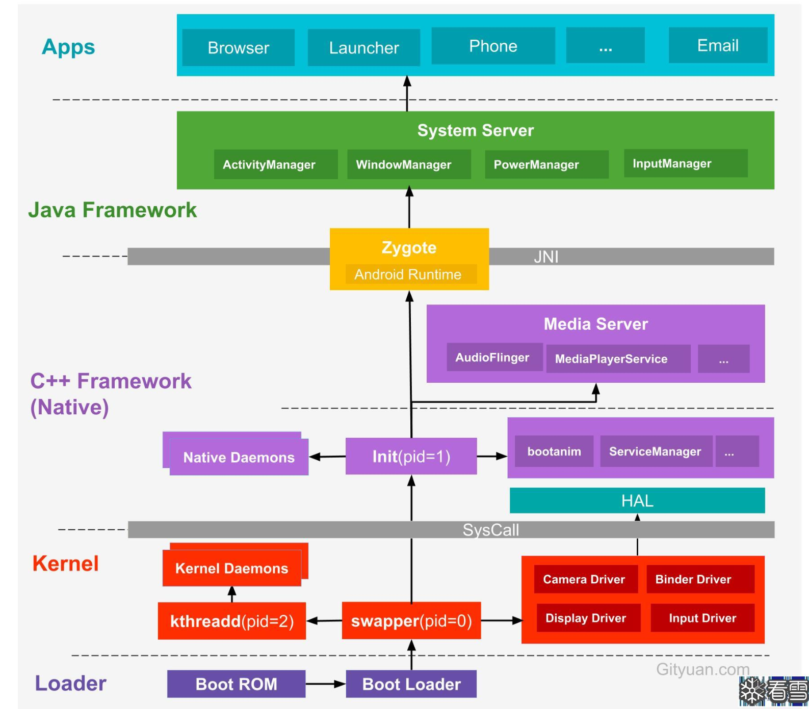
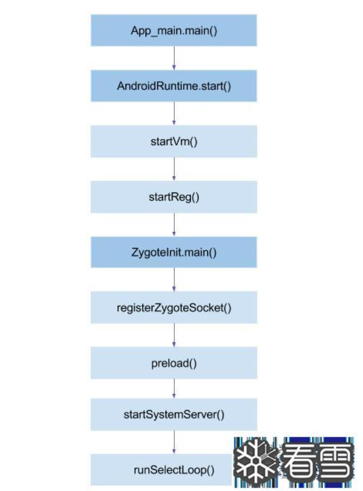
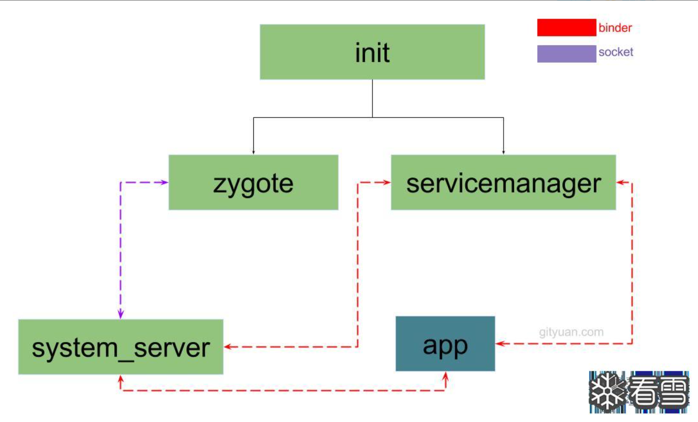

# Android各启动流程与机制杂谈

## Android内核启动流程

### 大致流程

引导加载程序-内核启动-init进程启动-Zygote进程启动-System Server进程-启动框架和用户界面



#### Loader

`SoC` 芯片内部有固化的一块只读存储器`Boot Rom`，芯片出厂时，厂商就把第一段启动代码烧录在里面，通常不可修改、掉电不丢失，电源键触发后，`CPU` 硬件从 `Boot ROM` 中的预设代码开始取指执行，`Boot ROM` 完成最基础的硬件初始化、启动介质检测和必要的安全校验后，从启动介质读取下一级引导程序，把它加载到 `SoC` 内部 `SRAM` 或已初始化好的 `RAM` 中，然后跳转执行，交出控制权，来到`Boot Loader`，`Boot Loader`带领进入`Kernel`层

#### Kernel

`bootloader` 把控制权交给 `Linux kernel`，进入内核入口执行 `start_kernel`，然后创建 `swapper` 也就是 `idle` 进程 `pid = 0`，初始化内存管理、调度、驱动等，最后启动用户空间第一个进程 `init` `pid = 1`，然后启动`kthreadd`，`pid = 2`，由 `swapper` 也就是 `idle` 在内核启动的 `rest_init` 里创建，它是所有内核线程的父进程，负责创建 `kworker`、`ksoftirqd`、`thermal` 等内核守护线程，`init` 此时开始解析 `init.rc`，转到`Native`层

#### Native

`init` 进程会孵化出许多用户守护进程，还启动 `servicemanager` 也就是 `binder` 服务管家、`bootanim` 也就是开机动画等重要服务，最重要的是`init` 进程孵化出 `Zygote` 进程，`Zygote` 进程是 `Android` 系统的第一个 `Java` 进程 即虚拟机进程，`Zygote` 是所有 `Java` 进程的父进程，此时进入了`JAVA Framework`层

#### JAVA Framework

此时`Zygote` 加载 `ZygoteInit` 类，注册 `Zygote Socket` 服务端套接字，加载虚拟机`ART`，提前加载类 `preloadClasses`，提前加载资源 `preloadResources`，后面 `fork` 出来的 `App` 直接继承，不用每个 `App` 都重新加载，启动更快也更省内存

`Zygote` 孵化的第一个进程是 `SystemServer`，此进程负责启动与管理整个 `Java Framework`，包含了 `ActivityManager`、`WindowManager`、`PackageManager`、`PowerManager` 等服务，给 `App` 和系统组件提供能力

#### App

`Zygote` 进程孵化出的第一个 `app` 进程为 `Launcher`，通俗来讲就是我们的桌面 `app`，所有的 `app` 进程都是由 `zygote` 进程 `fork` 而来的  

#### init详解

第一阶段先判断是不是第一阶段，因为第一阶段最后会 `execv` 重启 `/init`，再次进 `main` 时 `INIT_SECOND_STAGE` 已经设置，第二次会跳过第一阶段，这是入口判断

第一阶段主要是加载必要文件，用 `mount` 挂载 `tmpfs`、`proc`、`sysfs`、`selinuxfs` 等虚拟文件系统，创建设备节点比如 `/dev/kmsg`、`/dev/random`，设置 `SELinux`，初始化 `selinux_initialize(true)` 加载安全策略，恢复 `/init` 上下文 `selinux_android_restorecon("/init", 0)`，切换第二阶段并做域转换，设置 `setenv("INIT_SECOND_STAGE", "true", 1)`，用 `execv` 重新启动 `/init` 程序，把域从 `kernel` 切到 `init`  

第二阶段则重新初始化 `SELinux` 并恢复上下文，初始化属性系统，处理内核 `dt` 和 `cmdline`，导出 `ro.boottime.init` 等属性，清理第一阶段环境变量，建立 `epoll` 和信号处理，启动属性服务，解析 `/init.rc`，按脚本启动 `servicemanager`、`Zygote` 等关键服务

为什么需要两次`init`？一是环境不完整，二是 `SELinux` 域问题

第一次 `/init` 是内核直接执行的，这时根文件系统还是 `ramdisk` 临时根，`system`、`vendor` 等还没挂，`SELinux` 策略也还没加载，所以只能做最基础的事，挂 `tmpfs`、`proc`、`sysfs`、`selinuxfs`，建 `/dev/kmsg`、`/dev/random` 这些节点，挂必要分区，加载 `SELinux` 策略，恢复 `/init` 上下文

这些做完后，环境才够完整，才能解析 `/system/etc/init`、`/vendor/etc/init` 和完整 `init.rc`，启动 `Zygote`、`servicemanager` 这些服务，所以需要第二次执行 `/init`

且第一次 `/init` 跑在 `kernel` 域，权限太大，加载策略并 `restorecon /init` 后，用 `execv` 重新执行 `/init`，进程就会从 `kernel` 域切到 `init` 域，权限被策略约束，更安全

然后我们讨论到`init`->`zygote`的过程

##### init_to_zygote



`init` 第二阶段解析 `init.rc` 和 `import` 进来的 `init.zygote.rc`

```rc
service zygote /system/bin/app_process64 -Xzygote /system/bin --zygote --start-system-server
    class main
    socket zygote stream 660 root system
    onrestart write /sys/android_power/request_state wake
    onrestart restart audioserver
    onrestart restart cameraserver
    writepid /dev/cpuset/foreground/tasks
    critical
```

`init` 执行 `/system/bin/app_process64` 后，进入 `app_main.cpp` 的 `main`

追到`app_main.cpp`

```cpp
int main(int argc, char* const argv[])
{
    if (!LOG_NDEBUG) {
      String8 argv_String;
      for (int i = 0; i < argc; ++i) {
        argv_String.append("\"");
        argv_String.append(argv[i]);
        argv_String.append("\" ");
      }
      ALOGV("app_process main with argv: %s", argv_String.c_str());
    }

    AppRuntime runtime(argv[0], computeArgBlockSize(argc, argv));
    argc--;
    argv++;


    const char* spaced_commands[] = { "-cp", "-classpath" };
    // Allow "spaced commands" to be succeeded by exactly 1 argument (regardless of -s).
    bool known_command = false;

    int i;
    for (i = 0; i < argc; i++) {
        if (known_command == true) {
          runtime.addOption(strdup(argv[i]));

          ALOGV("app_process main add known option '%s'", argv[i]);
          known_command = false;
          continue;
        }

        for (int j = 0;
             j < static_cast<int>(sizeof(spaced_commands) / sizeof(spaced_commands[0]));
             ++j) {
          if (strcmp(argv[i], spaced_commands[j]) == 0) {
            known_command = true;
            ALOGV("app_process main found known command '%s'", argv[i]);
          }
        }

        if (argv[i][0] != '-') {
            break;
        }
        if (argv[i][1] == '-' && argv[i][2] == 0) {
            ++i; // Skip --.
            break;
        }

        runtime.addOption(strdup(argv[i]));

        ALOGV("app_process main add option '%s'", argv[i]);
    }
//运行模式
    // Parse runtime arguments.  Stop at first unrecognized option.
    bool zygote = false;
    bool startSystemServer = false;
    bool application = false;
    String8 niceName;
    String8 className;

    //提取argv中的模式与参数
    ++i;  // Skip unused "parent dir" argument.
    while (i < argc) {
        const char* arg = argv[i++];
        if (strcmp(arg, "--zygote") == 0) {
            zygote = true;
            niceName = ZYGOTE_NICE_NAME;
        } else if (strcmp(arg, "--start-system-server") == 0) {
            startSystemServer = true;
        } else if (strcmp(arg, "--application") == 0) {
            application = true;
        } else if (strncmp(arg, "--nice-name=", 12) == 0) {
            niceName = (arg + 12);
        } else if (strncmp(arg, "--", 2) != 0) {
            className = arg;
            break;
        } else {
            --i;
            break;
        }
    }

    Vector<String8> args;
    if (!className.empty()) {
        // We're not in zygote mode, the only argument we need to pass
        // to RuntimeInit is the application argument.
        //
        // The Remainder of args get passed to startup class main(). Make
        // copies of them before we overwrite them with the process name.
        args.add(application ? String8("application") : String8("tool"));
        runtime.setClassNameAndArgs(className, argc - i, argv + i);

        if (!LOG_NDEBUG) {
          String8 restOfArgs;
          char* const* argv_new = argv + i;
          int argc_new = argc - i;
          for (int k = 0; k < argc_new; ++k) {
            restOfArgs.append("\"");
            restOfArgs.append(argv_new[k]);
            restOfArgs.append("\" ");
          }
          ALOGV("Class name = %s, args = %s", className.c_str(), restOfArgs.c_str());
        }
    } else {
        //这里是在Zygote模式
        // We're in zygote mode.
        maybeCreateDalvikCache();//确保 Dalvik 缓存存在（如有必要则创建）

        if (startSystemServer) {
            args.add(String8("start-system-server"));
        }

        char prop[PROP_VALUE_MAX];
        if (property_get(ABI_LIST_PROPERTY, prop, NULL) == 0) {
            LOG_ALWAYS_FATAL("app_process: Unable to determine ABI list from property %s.",
                ABI_LIST_PROPERTY);
            return 11;
        }

        String8 abiFlag("--abi-list=");
        abiFlag.append(prop);//从系统属性中获取 ABI 列表（支持的架构），并将其作为 --abi-list 选项传递给 Zygote
        args.add(abiFlag);

        // In zygote mode, pass all remaining arguments to the zygote
        // main() method.
        for (; i < argc; ++i) {
            args.add(String8(argv[i]));
        }
    }

    if (!niceName.empty()) {
        runtime.setArgv0(niceName.c_str(), true /* setProcName */);
    }
//最后的部分是启动了java中的这个类/或者是独立模式
    if (zygote) {
        runtime.start("com.android.internal.os.ZygoteInit", args, zygote);
    } else if (!className.empty()) {
        runtime.start("com.android.internal.os.RuntimeInit", args, zygote);
    } else {
        fprintf(stderr, "Error: no class name or --zygote supplied.\n");
        app_usage();
        LOG_ALWAYS_FATAL("app_process: no class name or --zygote supplied.");
    }
}
```

`AppRuntime runtime(argv[0], computeArgBlockSize(argc, argv));`
创建 `AppRuntime`，它继承 `AndroidRuntime`，后面 `runtime.start` 实际调的是 `AndroidRuntime::start`，这里的`AppRuntime`，它的作用是收好参数，把流程带进 `AndroidRuntime`

`runtime.start("com.android.internal.os.ZygoteInit", args, zygote);`
，把 `native` 的 `app_process` 接到 `Java` 的 `ZygoteInit`

创建 `AppRuntime` 后，`main` 解析参数，判断是 `Zygote` 模式，最后调 `runtime.start("com.android.internal.os.ZygoteInit", args, zygote)`

`runtime.start` 实际进 `AndroidRuntime::start`，里面调 `startVm` 创建 `ART`，调 `startReg` 注册 `JNI`，然后用 `JNI` 找到 `ZygoteInit` 类，调它的静态 `main`

`ZygoteInit.main` 里先 `registerZygoteSocket` 注册 `zygote socket`，再 `preload` 预加载类和资源，然后 `startSystemServer` `fork` 出 `system_server`，最后 `runSelectLoop` 等 `AMS` 通过 `zygote socket` 发请求来 `fork` 新 `app`

## Android App启动流程



