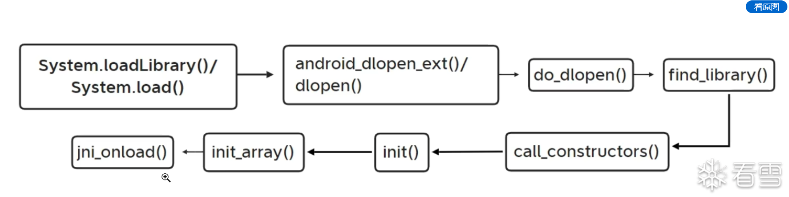

# Android native linker 学习

## 参考源码和文章

源码地址

- [AOSP bionic linker.cpp](https://android.googlesource.com/platform/bionic/+/lollipop-release/linker/linker.cpp)
- [AOSP bionic linker.h](https://android.googlesource.com/platform/bionic/+/lollipop-release/linker/linker.h)
- [AOSP bionic linker_phdr.cpp](https://android.googlesource.com/platform/bionic/+/lollipop-release/linker/linker_phdr.cpp)
- [AOSP Android Dynamic Linker Design Notes](https://android.googlesource.com/platform/bionic/+/jb-mr1-dev-plus-aosp/linker/README.TXT)
- [Frida JavaScript API](https://frida.re/docs/javascript-api/)
- [看雪 Android native 层 linker 文章](https://bbs.kanxue.com/thread-286004.htm)

关键函数的作用

- `dlopen()`，对外提供动态加载接口，负责加锁、调用内部加载流程和返回错误
- `do_dlopen()`，组织一次动态加载，最后进入构造函数阶段
- `find_library()`，查找已有库，或者触发新库加载并返回 `soinfo*`
- `load_library()`，打开文件并建立 ELF 的运行时映像
- `CallConstructors()`，处理依赖库，再调用当前库的初始化函数
- `CallFunction()`，调用一个已经解析出的函数指针
- `CallArray()`，遍历 `DT_INIT_ARRAY` 中的函数指针

流程图如下：

~~~text
dlopen
  ↓
do_dlopen
  ↓
find_library
  ↓
load_library
  ↓
依赖解析和重定位
  ↓
call_constructors
  ↓
依赖库初始化
  ↓
当前 SO 的 DT_INIT
  ↓
当前 SO 的 DT_INIT_ARRAY
  ↓
dlopen 返回
~~~

## soinfo 是什么

源码地址

- [AOSP bionic linker.h](https://android.googlesource.com/platform/bionic/+/lollipop-release/linker/linker.h)

关键函数和结构的作用

- `soinfo`，表示 linker 对一个已加载或正在加载的 SO 的管理记录
- `base`，记录映像的装载基址
- `load_bias`，帮助将 ELF 虚拟地址换算为运行时地址
- `phdr` 和 `phnum`，记录 program header 表
- 动态链接字段，关联符号表、字符串表、重定位和依赖信息
- 构造状态字段，避免重复执行初始化

~~~text
磁盘上的 libfoo.so
        ↓ ELF 装载
进程地址空间中的代码和数据
        ↓ linker 建立管理记录
libfoo.so 对应的 soinfo
~~~

## do_dlopen 和 find_library

源码地址

- [AOSP bionic linker.cpp](https://android.googlesource.com/platform/bionic/+/lollipop-release/linker/linker.cpp)

关键函数的作用

- `do_dlopen()`，检查标志，调用 `find_library()`，成功后进入构造阶段
- `find_library()`，返回已有 `soinfo`，或者触发新库的映射和链接

~~~cpp
soinfo* do_dlopen(const char* name, int flags) {
    // 检查 RTLD_NOW、RTLD_LAZY 等标志
    soinfo* si = find_library(name);

    if (si != NULL) {
        // 进入当前对象的初始化流程
        si->CallConstructors();
    }

    return si;
}
~~~

~~~text
do_dlopen
  → find_library
  → 返回目标 SO 对应的 soinfo
  → CallConstructors
~~~

## load_library 做什么

源码地址

- [AOSP bionic linker_phdr.cpp](https://android.googlesource.com/platform/bionic/+/lollipop-release/linker/linker_phdr.cpp)
- [AOSP early linker.c](https://android.googlesource.com/platform/bionic/+/761ba27/linker/linker.c)

关键函数的作用

- ELF reader，读取 ELF header 和 program headers
- 地址空间预留，计算整个映像需要的范围
- `PT_LOAD` 段映射，把代码、只读数据和可写数据放进进程空间
- 权限设置，根据段属性建立读、写、执行权限
- `soinfo` 创建和填写，记录映射结果

~~~text
磁盘文件
  ↓
读取 ELF header
  ↓
读取 program headers
  ↓
计算装载范围
  ↓
映射 PT_LOAD 段
  ↓
创建或填写 soinfo
~~~

不同 Android 版本可能把链接工作拆在不同函数中，因此应该先确认源码版本，再判断 load_library 的精确边界

## CallConstructors 的职责

源码地址

- [AOSP bionic linker.cpp](https://android.googlesource.com/platform/bionic/+/lollipop-release/linker/linker.cpp)
- [AOSP bionic main linker_soinfo.cpp](https://android.googlesource.com/platform/bionic/+/refs/heads/main/linker/linker_soinfo.cpp)

关键函数的作用

- `CallConstructors()`，进入某一个 SO 对象的初始化阶段
- 构造状态检查，避免同一个对象重复初始化
- 依赖递归，先处理依赖对象
- `DT_INIT` 调用，执行单个初始化函数
- `DT_INIT_ARRAY` 调用，遍历函数指针数组

~~~cpp
void soinfo::CallConstructors() {
    // 已经执行过时不重复执行
    if (constructors_called) {
        return;
    }

    // 提前标记，避免递归依赖造成重复进入
    constructors_called = true;

    // 先处理依赖库
    for (soinfo* child : dependencies) {
        child->CallConstructors();
    }

    // 再处理当前 SO
    CallFunction("DT_INIT", init_func);
    CallArray("DT_INIT_ARRAY", init_array, init_array_count);
}
~~~

上面是帮助理解的概念代码，不保证所有 Android 版本逐字相同

回看调用链

~~~text
target.CallConstructors()
  → 检查 constructors_called
  → 递归 dependency.CallConstructors()
  → 当前对象 DT_INIT
  → 当前对象 DT_INIT_ARRAY
~~~

## CallFunction 和 CallArray

源码地址

- [AOSP bionic linker.cpp](https://android.googlesource.com/platform/bionic/+/lollipop-release/linker/linker.cpp)

关键函数的作用

- `CallFunction()`，接收一个已经解析好的函数指针并执行
- `CallArray()`，遍历数组元素，并把每个元素交给 `CallFunction()`

~~~cpp
void CallFunction(const char* label, linker_function_t function) {
    // 空指针和无效指针不能调用
    if (function == nullptr) {
        return;
    }

    // 具体版本可能还会检查 -1 等无效值
    function();
}

void CallArray(const char* label,
               linker_function_t* functions,
               size_t count) {
    for (size_t i = 0; i < count; ++i) {
        // 数组元素保存的是函数指针
        CallFunction("function", functions[i]);
    }
}
~~~

调用层次可以写成

~~~text
CallConstructors
  ├─ CallFunction(DT_INIT 的函数指针)
  └─ CallArray(DT_INIT_ARRAY)
       ├─ CallFunction(array[0])
       ├─ CallFunction(array[1])
       └─ ...
~~~

这里的字符串参数主要用于日志或报错说明，不是用字符串去搜索函数

## DT_INIT 和 DT_INIT_ARRAY 的顺序

同一个 SO 的典型顺序是

~~~text
DT_INIT
  ↓
DT_INIT_ARRAY[0]
  ↓
DT_INIT_ARRAY[1]
  ↓
...
~~~

如果 `libA.so` 依赖 `libB.so`，整体顺序为

~~~text
libB.so 的 DT_INIT
libB.so 的 DT_INIT_ARRAY
libA.so 的 DT_INIT
libA.so 的 DT_INIT_ARRAY
~~~

## HOOK 获取最早时机

可以整理为下面四步

~~~text
1  先找到 linker 中的 call_constructors
2  用 Interceptor.attach 监听它
3  在 onEnter 中确认当前 soinfo 是否是目标对象
4  在 linker 继续运行前，对目标初始化函数安装 Hook 或进行明确的修改
~~~

实例如下：

~~~java
function Get(Soname){
    var Linker = Process.getModuleByName("linker64");
    //拿到Linker,接下来寻找call_function或者call_constructors，call_function虽然时机非常好，但是编译器内联等会导致找不到，这时候回退到call_constructors就行
    var symbols = Linker.enumerateSymbols(); 
    var call_function_addr = null;
    for(var i=0;i<symbols.length;i++){ 
        if(symbols[i].name.indexOf("__dl__ZN6soinfo17call_functionEv") !== -1){ 
            call_function_addr = symbols[i].address; 
            console.log("[+]find call_function in" + call_function_addr);
            console.log("---------------------------------------------")
            break;
        }
    }
    if (!call_function_addr) return; 

    Interceptor.attach(call_function_addr,
    {
        // call_function("DT_INIT", init_func_, get_realpath()); in call_constructors()
        onEnter:function(args){
            var sopath = ptr(args[2]).readUtf8String(); 
            if(sopath && sopath.indexOf(Soname) !== -1){ 
                console.log("[+]find target so");
                console.log("---------------------------------------------");
                hook1();
            }
        },
        onLeave:function(retval){
            hook2();
        }
    }); 

    return 0;
}

setImmediate(function() { 
    Get("target.so"); 
});
~~~

~~~text
call_constructors onEnter
  → 识别当前 soinfo
  → 取得目标对象的映像信息
  → 解析 DT_INIT 和 DT_INIT_ARRAY
  → 对真实函数入口 attach 或明确修改
  → 回调返回
  → linker 继续执行原初始化流程
~~~
